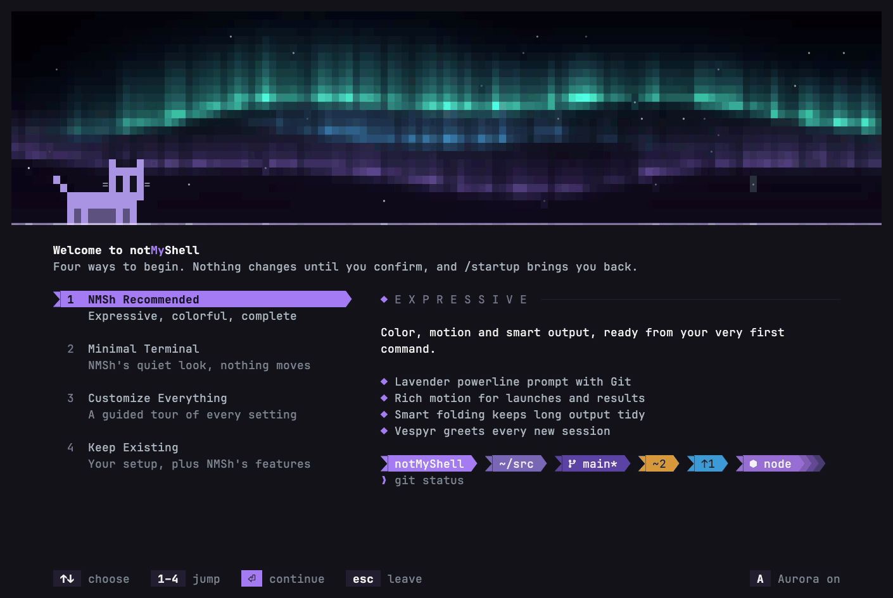

# First-run starting points (reactive Horizon)

Status: approved for production on 2026-10-17. Replaces the static centered
modal described under "Accepted refinements" in
[post-v020-preferences-onboarding.md](post-v020-preferences-onboarding.md).
The design exploration, every alternative and the superseded implementation are
preserved in [archive/first-run-onboarding-2026-10](archive/first-run-onboarding-2026-10/README.md).

## Intent

The first thing a new person sees should feel deliberately designed and should
not take anything from them. One screen offers four equally valid ways to
begin, shows what each one means with real previews or real evidence, and ends
by turning into the actual terminal rather than a picture of one.

Approved composition: **Horizon**, with **Stage's reactive Aurora** (the sky's
mood follows the highlighted choice) and **First Prompt's ending** (setup folds
away into the real transcript and composer).

## Goals and anti-goals

- Four starting points, visible together: NMSh Recommended, Minimal Terminal,
  Customize Everything, Keep Existing. Each is a legitimate way to use NMSh.
- The real Aurora engine (`renderScene('aurora')`) draws the sky. No second
  animation engine, no hand-rolled gradient.
- Nothing is applied because it is highlighted. Apply follows an explicit review.
- Keep Existing keeps what the person has and says plainly what NMSh cannot reproduce.
- Anti-goals: a centered rounded modal; light behind text; a fake terminal,
  fake command or simulated session at the end; an expressive welcome forced on
  Minimal or Keep Existing; a replayed welcome when the selector is reopened.

## Entry points and lifecycle

- **First run** (`!onboardingComplete && !introSeen`, not attached, no preset
  startup): `introSeen` persists first, then the selector opens. It never
  reopens on its own afterwards.
- **`/startup`** and **`/setup quick`**: the same selector, the same state,
  review, confirmation and Apply. `/setup` still opens the full guided setup;
  `/presets` and `nmsh --preset` keep their meaning. There is no `/preset`.
- Settings → General → **Starting point** opens the selector.

### Selector state (one source of truth)

`SetupState.quick` holds: `choice` (0–3), `review`, `confirm`/`confirmIndex`
(0 Stay, 1 Leave), `manual` (guided setup open over the selector), `layout`
(Minimal's `twoLine` | `oneLine`, default `twoLine`), `backdrop`
(`aurora` | `subtle` | `off`), `previousChoice` and `changedAt` (for the sky
cross-fade), `keep` (Keep Existing's answer and re-detect flag) and `evidence`
(the read-only detection result, filled asynchronously). `state.draft` is always
the highlighted choice's draft; `state.saved` is the configuration as saved.

| Screen | Keys |
| --- | --- |
| Choices | `↑↓` move · `1`–`4` jump · `←→`/`Tab` Minimal's layout when Minimal is highlighted · `⏎` review (Customize: open the guided setup) · `esc` Leave setup? · `A` Aurora on / subtle / off |
| Review | `⏎` Apply · `esc`/`←` back to the choices · `↑↓` answer Keep Existing's question when one is shown · `R` re-detect (Keep Existing on a configured install) · `A` |
| Leave setup? | `←→`/`Tab` choose · `⏎` confirm · `esc` Stay. Stay is focused first; Leave closes without applying anything. |
| Guided setup | its own keys; `esc` with no unapplied edits returns to the choices; with edits it asks first, then returns to the choices. |

### Starting points

| | Draft | Notes |
| --- | --- | --- |
| NMSh Recommended | The canonical fresh configuration's presentation | Shell, tools, integrations and accessibility are retained. Cursor effects are Off. |
| Minimal Terminal | `minimalPromptConfiguration(layout)` presentation | Two-line by default, One-line selectable; no effects, greeting or snapshots. |
| Customize Everything | The saved configuration, opened in the guided setup | Nothing applies until the guided setup's own Apply. |
| Keep Existing | See [Keep Existing](#keep-existing) | A no-op on configured installs unless re-detect is chosen. |

On Apply the config records `startingPoint` (`recommended` | `minimal` |
`customize` | `existing`): a label only, never used to recompute settings, not
exported. Reopening shows it as *current*. The effective configuration stays the
only source of truth; detection results are never saved.

## Composition

Columns × rows tiers, from the prototype:

- **Sky band**: rows `0 … skyH−1`, `skyH = max(4, min(round(0.42·rows), rows − ground))`
  with `ground = 22` (two columns) or `18` (single column); no sky under 20 rows.
  The ground's needs do not depend on the highlighted choice, so the sky never jumps.
- **Horizon line**: the first ground row draws `▔` across the full width, its
  color per column taken from the light in the sky's bottom row. It is never
  painted into the sky band, so it cannot touch Vespyr.
- **Vespyr** stands on the horizon at the left margin (≥ 56 columns, sky ≥ 5
  rows), composited into the sky grid pixel by pixel (see below). Blinks every
  6.4 s; flicks its tail for 360 ms when the highlighted choice changes.
- **Ground** (terminal background, unpainted): title row (*Welcome to
  notMyShell*, or *Your starting point* when reopened), one lead line, then:
  - ≥ 96 columns: a list of four on the left (width `clamp(round(0.34·cols), 34, 46)`)
    and a detail column on the right (≤ 72 columns);
  - < 96 columns: the list with the highlighted choice opened in place (accordion);
  - < 40 × 14: a plain four-line list and the keys.
- The highlighted choice is a powerline segment: the independent-segment notch,
  the label on the accent fill in dark ink, the end wedge pointing at the details.
- Details: an eyebrow, the lead, then proof — Recommended and Minimal list what
  they bring and show the real composer for the draft (Minimal adds its
  Two-line / One-line control); Customize shows the guided setup's steps as
  tiles; Keep Existing shows the read-only evidence and the detected prompt as
  NMSh would draw it, in neutral chrome.
- Footer: square keycaps; `A  Aurora on|subtle|off` on the right.
- Leave setup?: a sheet rising from the bottom (half-block top edge), Stay and
  Leave as filled keys; the ground behind it is drawn faint (never the sky).

The selector draws in the saved theme's chrome; previews draw with the
highlighted draft's settings.

## Reactive Aurora

The sky is `renderScene('aurora')` into one reused `CellGrid`. Moods are palette
transforms over the same engine (`src/idle/auroraMoods.ts`):

| Highlighted | Mood | Scene speed |
| --- | --- | --- |
| NMSh Recommended | Aurora: an aurora's green rim and blue glow with the theme's accent in the upper curtains, over the theme's own night | 1 |
| Minimal Terminal | Calm: the same colors dimmed 90 % toward the night; stars faint | 0.3 |
| Customize Everything | Spectrum: the Aurora preset's green, blue, violet and pink | 1 |
| Keep Existing | Out: the curtains fade to night, then the sky is not drawn; the horizon and Vespyr remain | — |

A change of highlight cross-fades the palette over 700 ms while the scene keeps
moving; a newer change restarts from the current blend (no queue). Backdrop
Subtle dims every mood 55 % and halves the cadence; Off draws no sky (Vespyr on
the hairline). Cadence: 200 ms (aurora), 320 ms (subtle), 40 ms while a
cross-fade or tail flick runs. After 60 s without a key the sky holds still;
the next key resumes it. Each frame repaints only the panel region; the
ground rows are cached per state and size.

## Vespyr compositing

`CellGrid` gains pixel-level composition: each cell is two vertical pixels
(`▀` upper = fg, lower = bg; `▄` the reverse; space = bg for both; transparent
= `NO_COLOR_VALUE`). Compositing a sprite pixel replaces only that half and
re-encodes the cell; the other half keeps its exact color, cells the sprite does
not cover are untouched, and transparent halves stay transparent (no background
escape). Whiskers are glyphs whose background is the mean of the two pixels
they cover. The horizon line lives in the ground row. Result: no rectangle,
halo or blended block around the silhouette, over a moving aurora, a still sky
or no sky at all.

## The ending

Apply persists and applies the configuration first (the new prompt, theme and
composer are live immediately), adds the transcript content, closes the
selector, and starts one presentation-only transition owned by `TerminalApp`
and painted after the ordinary transitions:

| ms | What happens |
| --- | --- |
| 0–180 | The selector's ground rows recede (drawn faint over the real frame, then gone). |
| 0–520 | The sky folds upward (`h(t)` eases from `skyH` to 0) on the real engine; the horizon line rides its bottom edge, Vespyr standing on it, up and out of view. |
| 520–760 | The horizon has become one luminous rule at the top; it fades out. It sits behind the real row: it fills only the cells after the row's own text, never over or between it, and never a row that paints its own background. |
| 240–880 | The real composer rises from below the bottom edge into its own position (`bottom` a short rise, `flow`/`top` a long one), new configuration and all. |
| 480 → | On a genuine first run with Recommended, Vespyr's block appears, then the welcome's lines one every 70 ms (a wrapped paragraph is one line and a spacer arrives with the line after it, so all of it lands within 600 ms); one light sweep crosses its headline, Vespyr blinks. |

The caret is hidden until the composer lands, then shown in the real composer.
Any key or resize finishes the transition at once and the key is then handled
normally. Reduced Motion or Effects Off in the configuration the selector ran
under (its sky did not move either), or no color: the completed state appears
immediately. The ending belongs to the selector, so applying Minimal from a
moving selector still folds it away; reopening `/startup` afterwards, with
Minimal's effects off, does not. Rows outside the transition's own drawing are the real frame's
rows, so nothing is cleared and nothing is left behind.

Transcript content on Apply (no command echo, no fake prompt):

- Genuine first run + Recommended: the Vespyr welcome block (as configured) and
  the first-run welcome — *You're all set. Welcome to notMyShell!* · *We're so
  glad you're here. Your shell is still yours; NMSh just makes it a nicer place
  to live.* · `/guide`, `/btw`, `F1`, `/startup` · *The aurora lives on in
  /screensaver.* — stored with the transcript, shown once.
- Every other Apply: one receipt line, for example *✓ Minimal Terminal is ready
  · Two-line · /startup changes it anytime*.

## One-time window maximization

Added 2026-10-18 at the maintainer's request (with Linux and Omarchy/Hyprland
addenda). The larger window exists only to make the first run better; NMSh never
takes ongoing ownership of the window's size. Portable onboarding comes first:
the selector, sky, Vespyr, keys, compact layouts and the ending never depend on
it, and no platform code enters shared onboarding or rendering code.

- **When.** Only the genuine first-ever onboarding (`introSeen` false), never
  `/startup` or a later launch, and only after a read-only probe in the
  background proved the window is NMSh's own and in its normal state. Then one
  quiet row above the footer: *Use more screen space for setup?* **M** Maximize
  for setup · **K** Keep current size (shorter wordings when narrow; one line in
  the tiny list). It answers once; nothing is maximized without **M**.
- **What.** macOS zoom (title bar, desktop and Space kept) or Hyprland's native
  maximized state (bar, gaps, workspace, tiling or floating kept). Never native
  fullscreen, never a blind toggle: the prior state is read first and re-checked
  right before acting.
- **Back.** After the ending finishes (one resize, never during the transition),
  at once on Leave, and synchronously on exit; only what NMSh changed, and only
  while the window is still exactly as NMSh left it, so manual moves, resizes,
  un-maximizing and fullscreen are respected.
- **Never.** Saved anywhere (process memory only); configuration of Ghostty,
  kitty, Terminal.app, Hyprland or Omarchy written; Accessibility, xdotool,
  wmctrl, ydotool, keyboard injection, focus or pointer moves; shell text. Every
  command is an absolute executable with argv and a timeout.
- **Hosts.** Terminal.app (AppleScript on the window whose tab is this tty),
  kitty on macOS (remote control over `KITTY_LISTEN_ON` only, ownership proven by
  ancestry, `ls --match`, the window's tty and CoreGraphics), Hyprland 0.55+ with
  a Lua configuration (`hl.dsp.window.fullscreen` naming the window's address,
  `set`/`unset`). Everything else — Ghostty on macOS, other Linux desktops, X11,
  older or hyprlang-configured Hyprland, SSH, multiplexers, editors' terminals,
  Windows and WSL — is unsupported, silently, with an explicit reason for logs
  and tests (`unsupported`, `permissionDenied`, `uncertainIdentity`,
  `alreadyMaximized`, `fullscreen`, `failed`).

Support matrix and the physical checklists:
[first-run window maximization](../testing/first-run-window-maximization.md).

## Keep Existing

NMSh runs the person's real shell and sources their own startup files, so
aliases, functions, PATH and plugin hooks survive. It also owns line editing
(ZLE off, Bash `--noediting`) and blanks the shell's own prompt every cycle;
prompts reach the screen only through NMSh's adapters.

| Preserved exactly | Through an existing adapter | Not reproducible today |
| --- | --- | --- |
| Terminal host palette, background, font, transparency, cursor (no host config is written; no managed cursor shader) | Starship (`starship prompt`, multi-line flattened, no right prompt; its trailing prompt character is dropped so only NMSh's marker shows) | Custom `PS1`/`PROMPT`, Oh My Zsh themes other than p10k, pure, spaceship, Fish `fish_prompt`, Tide |
| Shell and startup files, aliases, functions, environment, non-UI hooks | Powerlevel10k (isolated `zsh -f`; gitstatus off; no right, instant or transient prompt) | ZLE/readline widgets, vi-mode, autosuggestions, syntax highlighting (NMSh's composer stands in) |
| `starship.toml`, `~/.p10k.zsh`, Oh My Posh configs, tool themes (read, never written) | Oh My Posh (`oh-my-posh print primary`, remote configs never fetched) | Right, transient and async prompt features; banners printed by rc files |
| Saved NMSh preferences on configured installs; Theme Bridge stays independent | zoxide and Atuin as Navigation and History providers | NMSh chrome in the host's exact palette (no ANSI-indexed chrome yet) |

### Read-only detection (`src/setup/environment/`)

- Shell: `$SHELL` against the shell adapter registry.
- Startup files of that shell, read as text with a 512 KiB cap per file,
  following plain `source`/`.` lines one level and only inside `$HOME`, at most
  16 files; comments ignored; nothing executed.
- Evidence patterns: `starship init`, `oh-my-posh init … --config`, p10k theme
  lines, `ZSH_THEME`, `PROMPT=`/`PS1=` assignments, `prompt <theme>`,
  `functions/fish_prompt.fish`, Tide, `zoxide init`, `atuin init`.
- Install and config facts from the existing `detectStarship`,
  `detectPowerlevel10k`, `detectOhMyPosh` and `resolveCommand` (PATH plus
  `--version` only).
- States: **active** (started by a startup file and runnable), **broken**
  (started but not runnable), **configured** (config file, not started),
  **installed** (binary or theme only).

Decision rules:

1. Configured install (`onboardingComplete`): Keep Existing changes nothing.
   `R` re-detects and shows the resulting diff for review.
2. Exactly one active prompt: keep it, with its config path.
3. Several active: ask which; one prompt runs at a time.
4. None active (custom, shell default, configured-but-not-started or broken):
   say so and ask — **Composer only** (Prompt None, the default; nothing
   imitates theirs) or **NMSh Minimal**. A configured-but-not-started provider
   is offered by name. Nothing is installed.
5. Never: run startup files, download, install, edit rc/terminal/theme files,
   or enable two prompts. The optional prompt-capture adapter from the review
   is not part of this slice.

Fresh-install draft: the detected shell (if supported); the chosen prompt;
detected zoxide/Atuin as providers; Grayscale chrome and syntax; Chroma, effects,
shimmer and idle visuals off; clean motion; host cursor; welcome none; Normal
transcript, Flow composer, Two-line; terminal title off; Theme Bridge unchanged.

## Defaults and migration

- Minimal defaults to Two-line; One-line stays available.
- Fresh and Recommended cursor effects are Off.
- Choosing Fire starts on the Classic gradient; Purple, Blue, Green, Follow
  theme and Custom remain. The existing particle model's default is Classic.
- Saved or imported explicit preferences keep their values; only missing fields
  take defaults, as before.

## Accessibility and capability

Reduced Motion: one still sky frame, no clock, no ending animation. Effects
Off: no sky motion and no ending. `NO_COLOR` or 16-color hosts: no sky; the
selection is reverse video; the horizon is a plain rule. Safe glyphs: ASCII
segment ends and rules. All four choices, the keys and Leave stay reachable down
to 16 × 6.

## Performance

Prototype baselines at 130×38, Aurora on: Horizon ~3.0 ms per frame and
~258 KB/s (screensaver: ~450 KB/s at 120×40). Production repaints only the
panel region, caches the ground, reuses one `CellGrid`, never schedules more
than one clock, and holds still after 60 s idle. `scripts/startup-benchmarks.ts`
measures 100×30, 130×38 and 200×55.

Measured 2026-10-18 (Node 26, Apple silicon, 60 frames per case, bytes after
row diffing):

| Case | 100×30 | 130×38 | 200×55 |
| --- | --- | --- | --- |
| Aurora at rest, 200 ms: median ms · KB/s | 0.35 · 88 | 0.69 · 221 | 1.35 · 450 |
| Calm at rest, 200 ms | 0.28 · 65 | 0.63 · 138 | 1.25 · 251 |
| Spectrum at rest, 200 ms | 0.29 · 88 | 0.76 · 221 | 1.41 · 449 |
| Out at rest (still sky) | 0.02 · 0.1 | 0.04 · 0.1 | 0.05 · 0.1 |
| Cross-fade into Aurora, 40 ms for 700 ms | 0.30 · 478 | 0.66 · 1144 | 1.33 · 2430 |
| The ending, 40 ms for 880 ms | 0.21 · 107 | 0.17 · 234 | 0.31 · 489 |

p95 stays under 3 ms (one 5.9 ms outlier); after an unsubscribe the clock has no
subscribers and no pending timer.

## Acceptance criteria

| # | Criterion |
| --- | --- |
| AC-1 | First run opens the selector once (introSeen first); `/startup`, `/setup quick` and Settings open the same selector; `/setup`, `/presets`, `--preset` unchanged; no `/preset`. |
| AC-2 | Four choices are visible together at every tier; `↑↓`, `1`–`4` select; highlight never applies anything. |
| AC-3 | Review then explicit Apply; `esc` from review returns to the choices; `esc` from the choices asks *Leave setup?* with Stay first; Leave applies nothing. |
| AC-4 | Minimal: Two-line default, One-line selectable on the real draft; Apply persists it. |
| AC-5 | Customize opens the guided setup over the saved configuration in the Horizon language; leaving it returns to the choices; nothing unfinished applies. |
| AC-6 | The sky is the real Aurora engine; its mood follows the highlight (aurora, calm, spectrum, out) with a 700 ms cross-fade; rapid changes never queue or flash. |
| AC-7 | `A` cycles Aurora on, subtle, off, persists `onboardingBackdrop`, and a Settings row offers the same. |
| AC-8 | Vespyr composites without a background rectangle over a moving aurora, a still sky and no sky; the horizon never overwrites it. |
| AC-9 | Apply runs the ending: ground recedes, sky folds into a rule that fades, the real composer rises into place; caret hidden until it lands; a key or resize finishes it; Reduced Motion shows the end state at once. |
| AC-10 | Genuine first run + Recommended adds the welcome in the real transcript; every other Apply adds one receipt line; reopening never replays the welcome. |
| AC-11 | Keep Existing detects read-only, distinguishes active/configured/installed/broken, keeps one active provider, asks for several, offers Composer only or NMSh Minimal otherwise, writes nothing outside NMSh's config, and is a no-op on configured installs unless re-detected. |
| AC-12 | Requested defaults (Minimal Two-line, cursor effects Off, Fire Classic) hold for fresh configs; explicit saved preferences survive. |
| AC-13 | Reduced Motion, Effects Off, NO_COLOR, 16 colors and Safe glyphs degrade as specified; 16 × 6 still offers all choices, Apply and Leave. |
| AC-14 | No timer, subscription or grid outlives the selector or the ending; frames stay within budget at 100×30–200×55. |
| AC-15 | Starship's trailing prompt character is dropped from a flattened multi-line prompt; single-line prompts are unchanged. |
| AC-16 | The window offer appears only on the genuine first run and only for a proven, normal window; M maximizes once, K never does; the window is put back after the ending, on Leave and on exit, never over a user's change; nothing is saved; unsupported hosts see no offer. |

## Traceability

| AC | Tests |
| --- | --- |
| AC-1 | `startupSelector.test.ts` (routes, first-run gate), `postV020Onboarding.test.ts` (introSeen, attach), `slashCommands` assertions |
| AC-2, AC-3, AC-4 | `startupSelector.test.ts` (keys, review, back, confirm, layout) |
| AC-5 | `startupSelector.test.ts` (customize round-trip), `setupCat.test.ts` (guided setup render) |
| AC-6, AC-7 | `startupSky.test.ts` (moods, cross-fade, cadence), `startupApp.test.ts` (A persistence, Settings row, clock) |
| AC-8 | `vespyrCompositing.test.ts` |
| AC-9, AC-10 | `startupEnding.test.ts` (frame-by-frame, keys, resize, reduced motion, receipts, welcome once) |
| AC-11 | `environmentDetection.test.ts`, `keepExisting.test.ts` |
| AC-12 | `postV020Preferences.test.ts` |
| AC-13 | `startupRender.test.ts` (tiers, NO_COLOR, safe, 16 colors, 16×6) |
| AC-14 | `startupApp.test.ts` (disposal), `scripts/startup-benchmarks.ts` |
| AC-15 | `starshipPrompt` assertions in `environmentDetection.test.ts` |
| AC-16 | `hostWindow.test.ts` (routing, Terminal.app, kitty, Hyprland, the one-time session, a real Linux pty), `startupWindow.test.ts` (offer, keys, restore points); physical checklists in the testing document |

## Verification

Focused suites while building; `npm run verify:release` at the end with
`NMSH_TEST_TMPDIR` on the T7; `scripts/startup-benchmarks.ts` (median and p95
milliseconds and KB/s per mood and size, the cross-fade and the ending);
`scripts/dev/startup-captures.ts` (production ANSI, SVG and VHS PNG frames, and
the built app's real first run recorded by VHS in a disposable T7 home) with a
side-by-side page against the archived references; the physical checklists for
the window offer in
[first-run window maximization](../testing/first-run-window-maximization.md).
